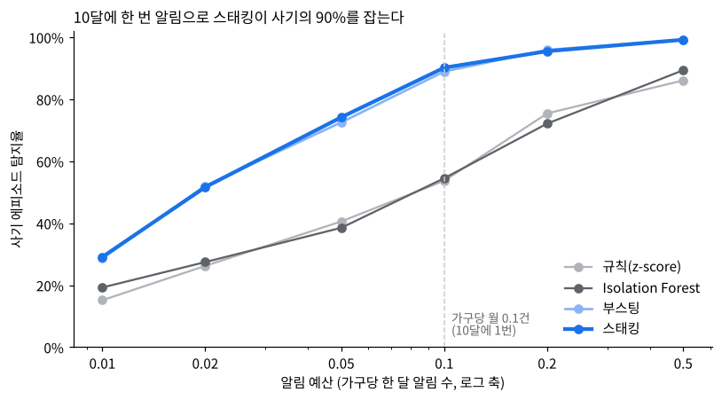
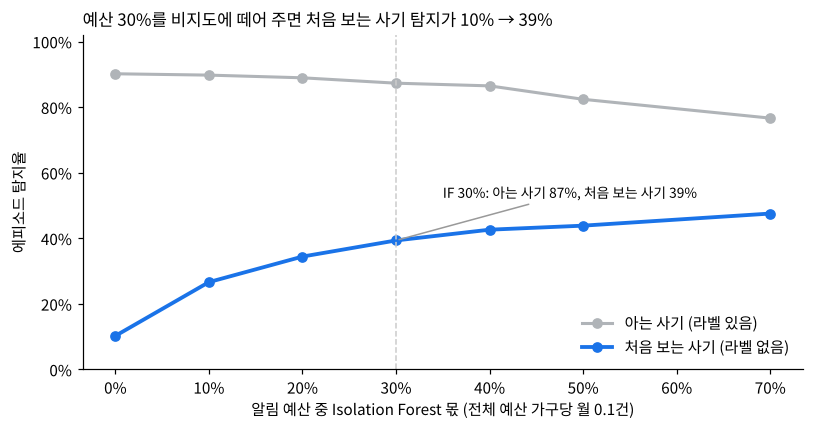
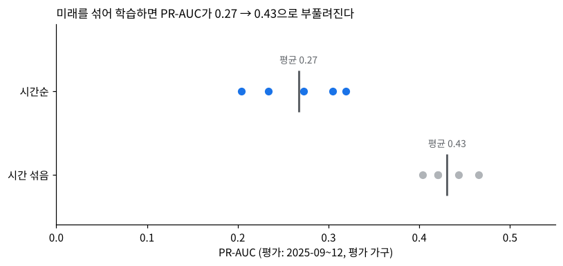
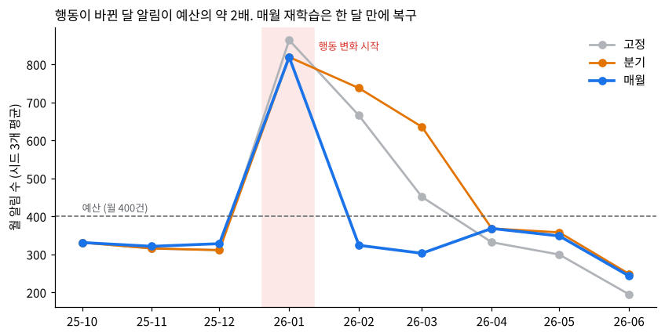

# 곁(GYEOT) — 고령자 이상거래 탐지

고령자 계좌의 사기·착취 거래를 잡는 탐지 모델 실험이다. 가상 거래 데이터를 쓰며, 알림 예산 안에서 **지도학습 + 비지도 2트랙**으로 알림을 나누는 구조를 제안한다.

> 모든 데이터는 직접 만든 가상 데이터다. 실제 금융 데이터는 쓰지 않았다.

## 핵심 결과

| 항목 | 결과 |
| --- | --- |
| 데이터 | 4,000가구 · 1,130,613건 · 사기 에피소드 244개 (4가지 유형) |
| 평가 | 2025-04-01 이후 850,958건, 가구 단위 GroupKFold(5) |
| PR-AUC | 규칙 0.029 · Isolation Forest 0.062 · 부스팅 0.354 · 스태킹 0.376 |
| 탐지율 (가구당 월 0.1건 알림) | 스태킹 90% · 부스팅 89% · IF 55% · 규칙 54% |
| 처음 보는 사기 (유형 하나를 학습에서 뺐을 때) | 지도학습만 쓰면 10%, 예산 30%를 IF에 배분하면 39%. 이때 아는 사기는 90% → 87% |
| 현실 발생률 보정 정밀도 | 19.5% → 1.5%. 한 가구가 헛알림을 받는 빈도는 약 14개월에 한 번 |
| v3 검증 (시드 5개 반복) | 스태킹 탐지율 87%±3% (v2 방식) → 87%±1% (v3: 수축 z-score, nested CV) |
| v3 시간순 검증 (과거로 학습 → 미래 평가) | PR-AUC 0.43 → 0.27, 탐지율 87% → 81%. 실전에 가까운 숫자는 이쪽 |
| v4 시간창 피처 (최근 72시간·7일을 묶어 판단) | 스태킹 86% → 89%, 비지도 단독 대면편취 0% → 46%, 2트랙 처음 보는 사기 36% → 40% |
| v4 드리프트 시뮬레이션 (18개월, 신종 수법·행동 변화) | 행동 변화 달 알림 약 2배·PSI 0.43 경고. 매월 재학습은 1개월, 분기는 3개월 걸려 복구. 카드 기반 신종은 라벨 도착 전까지 0% |






## 구조

```
거래 발생
 → 그 가구의 과거 거래만 조회 (누수 방지)
 → 피처 15개 (개인 기준선 z-score, 새 수취인, 24시간 출금 배율, 48시간 내 대출 등)
 → Isolation Forest 점수 (비지도, 라벨 불필요)
 → IF 점수를 16번째 피처로 넣은 부스팅 = 스태킹 점수
 → 알림 예산의 70%는 스태킹, 30%는 IF로 컷 결정 → 둘 중 하나라도 넘으면 알림
 → 알림 사유 2개 생성 ("처음 보는 계좌로 송금 · 평소 송금 금액의 약 15배")
```

실제 거래 한 건이 이 과정을 거쳐 판단되는 예시는 [docs/example_walkthrough.md](docs/example_walkthrough.md)에 정리했다.

## 폴더

| 경로 | 내용 |
| --- | --- |
| `notebooks/gyeot_fraud_detection_v2.ipynb` | 본 노트북: 데이터 → 피처 → 모델 비교 → 처음 보는 사기 실험 → 2트랙 설계 → 정밀도 보정 → 알림 사유 |
| `notebooks/gyeot_fraud_detection_v3.ipynb` | 한계 수정과 검증: 수축 추정 z-score, nested CV 스태킹, 하이퍼파라미터 탐색, 시드 5개 반복, 시간순 검증 |
| `notebooks/gyeot_fraud_detection_v4.ipynb` | 사건 단위 판단(시간창 피처), 운영 중 드리프트·재학습 주기·PSI 모니터링, 운영 규칙 제안 |
| `notebooks/gyeot_modeling_v1.ipynb` | 첫 버전 |
| `src/gen_data.py` | 가상 거래 데이터 생성기 (정상인데 튀는 거래, 4가지 사기 시나리오 포함) |
| `src/features.py` | 과거 정보만 쓰는 피처 계산 (벡터화된 시간창 집계) |
| `src/features_v3.py` | v3 피처: 수축 추정 z-score(`z_shrink`), 과거 건수(`hist_n`) |
| `src/exp_seeds.py` | 시드 반복·시간순 검증 실험 코드 |
| `src/features_v4.py` | v4 시간창 피처 6개 (72시간 ATM·출금, 7일 새 수취인) |
| `src/gen_data_v4.py` | 18개월 드리프트 데이터 생성기 (신종 수법 2종, 간편송금 확산) |
| `src/exp_window.py`, `src/exp_drift.py` | 시간창 피처 실험, 재학습 주기·PSI 실험 |
| `results/` | v3·v4 실험 결과(json, csv) |
| `docs/example_walkthrough.md` | 거래 한 건의 판단 과정 |
| `figures/` | 노트북 결과 그림 |

## 실행

```bash
pip install -r requirements.txt
jupyter notebook notebooks/gyeot_fraud_detection_v2.ipynb
```

노트북 안에 데이터 생성 코드가 포함되어 있어 따로 데이터를 받을 필요가 없다. 전체 실행에는 수 분이 걸린다.

## v3에서 확인한 것

- v2의 "탐지율 90%"는 시드 하나의 숫자였다. 시드 5개 평균은 87%, 시간순으로 검증하면 81%다. 모델 간 순위(스태킹 > 부스팅 > IF > 규칙)와 2트랙 결론은 유지된다.
- 기록 3건 미만이면 z=0이던 구멍을 수축 추정으로 메웠다. 탐지율 평균은 그대로지만 시드 간 편차가 3분의 1로 줄었다.
- nested CV로 바꿔도 PR-AUC 차이는 0.03 안팎이었다.
- 하이퍼파라미터 튜닝은 튜닝 구간 안에서만 효과가 보였다. 사기 사례가 240건 수준이라 PR-AUC 0.02 차이는 잡음이다.

## v4에서 확인한 것

- 최근 며칠을 묶어 보는 피처를 더하자 비지도 모델이 대면편취를 처음으로 잡기 시작했다(0% → 46%). 다만 알림 예산을 나누면 여전히 거의 못 잡아, 대면편취는 신고 라벨 확보가 답이라는 결론은 유지된다.
- 운영 중 고객 행동이 바뀌면 고정된 알림 기준이 헛알림을 두 배로 만든다. PSI와 알림 수는 라벨 없이 당일 알 수 있는 경보다.
- 비지도 트랙은 피처가 보는 범위 안에서만 안전망이다. 송금·인출 위주 피처로는 카드 기반 신종을 못 봤다. 새 거래 경로가 생기면 그 경로의 피처부터 추가해야 한다.
- 운영 규칙: 매월 재학습, PSI 0.25 또는 알림 1.5배 초과 시 즉시 재학습, 신고된 신종 사례는 지연 없이 학습에 반영.

## 한계

- 가상 데이터라서 실제 사기 패턴과 다를 수 있다. 숫자는 구조를 비교하기 위한 것이다.
- 평가 구간에 '처음 보는 유형'이 실제로 등장하는 상황은 LOSO로 흉내 냈을 뿐이다.
- 라벨 지연을 모든 사기에 30일로 똑같이 뒀다. 실제로는 놓친 사기는 라벨이 아예 안 들어오는 편향이 있다.
