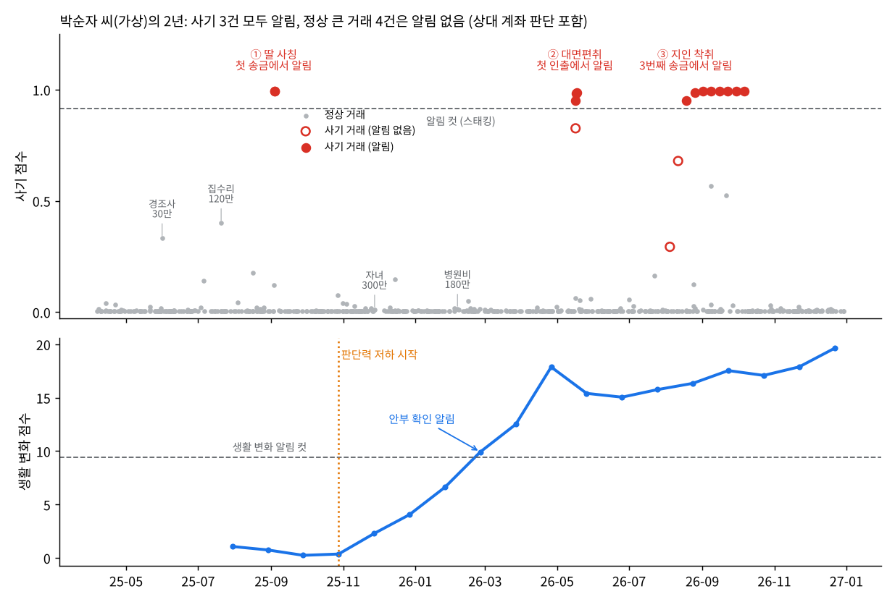

# 사례 연구: 박순자 씨(가상)의 2년

가상의 인물 한 명의 2년 치 거래를 만들고, 개인 프로필, 상대 계좌 판단, 사기 탐지(2트랙), 판단력 저하 감지를 그대로 돌렸다. 코드는 `src/case_study.py`, 결과는 `results/case_tx.csv`, `results/case_decline.csv`, `results/case_profile.md`.

## 인물과 설정

박순자(가상), 76세, 혼자 거주. 모델은 이 인물이 없는 4,000가구로 만들었다. 3,200가구로 학습하고 800가구로 알림 컷을 정했다(가구당 월 0.1건, 스태킹 70% + IF 30%). 같은 컷에서 800가구의 사기 사건 40건 중 87.5%가 잡혔다.

첫 사기 직전(2025-09-01)까지의 기록으로 만든 프로필은 다음과 같다.

- 들어오는 돈 월 90만 원, 나가는 돈 월 158만 원. 연금보다 많이 써서 예금을 헐고 있다.
- 이분에게 큰돈은 한 번에 22만 원 이상(상위 5%). 그때까지 최대는 집수리 120만 원.
- 카드 월 16회(보통 2만 원), 현금 인출 월 1.8회(보통 18만 원), 송금 월 2.1회(보통 11만 원), 공과금 3건(8일, 16일, 23일 무렵).
- 거래는 주로 8시~17시, 밤 거래 2%.
- 송금 상대는 오래 거래한 지인 2명이 대부분이다.

## 일어난 일과 판단

| 날짜 | 사건 | 실제 | 상대 판단 | 사기 점수 (컷 0.916) | 결과 |
| --- | --- | --- | --- | --- | --- |
| 2025-05-31 | 처음 보는 계좌로 30만 원 (경조사) | 정상 | 처음 보는 계좌, 다른 고객 기록 없음 | 0.33 | 알림 없음 |
| 2025-07-20 | 집수리 업체에 120만 원 | 정상 | 처음 보는 계좌 (48일 전부터 다른 고객 1명 이용) | 0.40 | 알림 없음 |
| 2025-08-16 | 부고 계좌에 10만 원 | 정상 | 최근 생긴 계좌에 4명이 소액 (경조사 추정) | 0.18 | 알림 없음 |
| 2025-09-03 14:52 | 딸 사칭 ① 280만 원 | 사기 | **위험: 생긴 지 2일 된 계좌에 다른 고객 1명도 처음으로 큰돈** | 0.992 | **알림** |
| 2025-09-03 15:32 | 딸 사칭 ② 150만 원 | 사기 | 같음 | 0.992 | **알림** |
| 2025-10-28 | 판단력 저하 시작 | | | | |
| 2025-11-27 | 자녀에게 300만 원 | 정상 | 오래 거래해 온 상대(9개월째), 다만 평소의 28배 | 0.01 | 알림 없음 |
| 2026-02-05 | 병원비 카드 180만 원 | 정상 | (송금 아님) | 0.02 | 알림 없음 |
| 2026-02 말 | 생활 변화 점수가 컷을 넘음 | | | | **안부 확인 알림** |
| 2026-05-16 10:04 | 대면편취 현금 ① 70만 원 | 사기 | (현금, 상대 없음) | 0.949 | **알림** |
| 2026-05-16~17 | 대면편취 ②③④ | 사기 | | 0.83, 0.985, 0.985 | ② 없음, ③④ **알림** |
| 2026-08-04, 08-11 | 지인의 착취 ①② 30만 원 안팎 | 사기 | 오래 거래해 온 상대(11개월째) | 0.29, 0.68 | 알림 없음 |
| 2026-08-18~ | 지인의 착취 ③~⑩ | 사기 | 오래 거래해 온 상대, 다만 최근 4주 보내는 돈이 크게 늘었음 | 0.95~0.99 | **알림** (③부터 매번) |

2025-05에서 2026-04까지의 프로필 변화도 같이 보인다. 2026-05-01 기준 최근 3개월은 평소와 비교해 현금 인출이 월 2.2회 → 4.9회, 공과금 납부가 월 3.1건 → 2.1건, 밤 거래가 3% → 11%였다.

## 상대 계좌 판단을 넣기 전과 후 (같은 사람, 같은 조건)

| | 넣기 전 | 넣은 뒤 |
| --- | --- | --- |
| 집수리 120만 원 (정상) | 점수 0.98, **헛알림** | 점수 0.40, 알림 없음 |
| 자녀 300만 원 (정상) | 점수 0.37 | 점수 0.01 |
| 딸 사칭 | 첫 송금에서 알림 | 첫 송금에서 알림 + "다른 고객도 당한 계좌"라는 사유 |
| 대면편취 | 4번째 인출에서 알림 (215만 원 나간 뒤) | 첫 인출에서 알림 |
| 지인의 착취 | 4번째 송금에서 알림 (87만 원 나간 뒤) | 3번째 송금에서 알림 (62만 원 나간 뒤) |
| 사기와 무관한 헛알림 | 1건 | 0건 |

집수리 헛알림이 사라진 것과 사칭 알림에 사유가 붙은 것은 상대 계좌 정보 덕분이다. 대면편취와 착취의 알림이 빨라진 것은 상대 계좌와 무관하다. 대면편취는 현금이라 상대가 없고, 착취 상대는 다른 고객과 무관한 개인이다. 모델을 다시 학습하면서 컷과 점수가 조금 움직인 결과이고, 다른 인물이었다면 반대로 나올 수도 있다.

## 숫자로 보면 (상대 계좌 판단 포함)

| 사건 | 피해 총액 | 첫 알림 전에 나간 돈 | 첫 알림 뒤에 남아 있던 돈 |
| --- | --- | --- | --- |
| 딸 사칭 | 430만 원 | 0원 | 150만 원 (40분 여유) |
| 대면편취 | 275만 원 | 0원 | 205만 원 (5시간 반 뒤 다음 인출) |
| 지인의 착취 | 약 259만 원 | 약 62만 원 | 약 171만 원 (일주일 간격) |

21개월 동안 거래 562건 중 알림은 13건이고 모두 사기 거래였다.

## 읽을 때 주의

- 한 사람, 한 번의 난수로 만든 예시다. 통계가 아니라 모델이 어떻게 움직이는지 보여주는 그림이다.
- 딸 사칭의 대포통장은 이틀 전 다른 피해자가 이미 당한 계좌로 설정했다. 박순자 씨가 첫 피해자였다면 상대 판단은 "처음 보는 계좌"에 그친다.
- 착취를 잡은 건 학습 데이터에 착취 라벨이 있어서다.
- 판단력 저하가 4개월 만에 잡힌 건 신호 크기를 v5 가정대로 뒀기 때문이다. 신호가 그 1/4이면 1년 안에 잡힐 확률은 약 32%다(v6).
